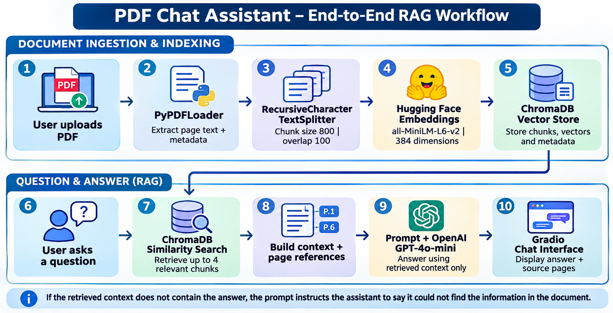
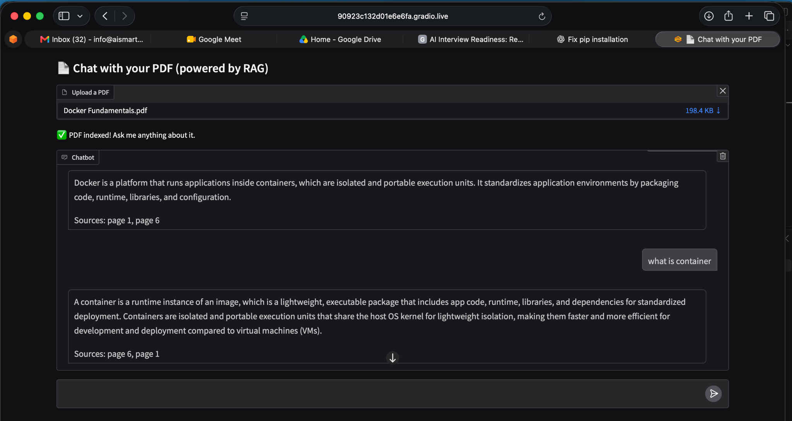
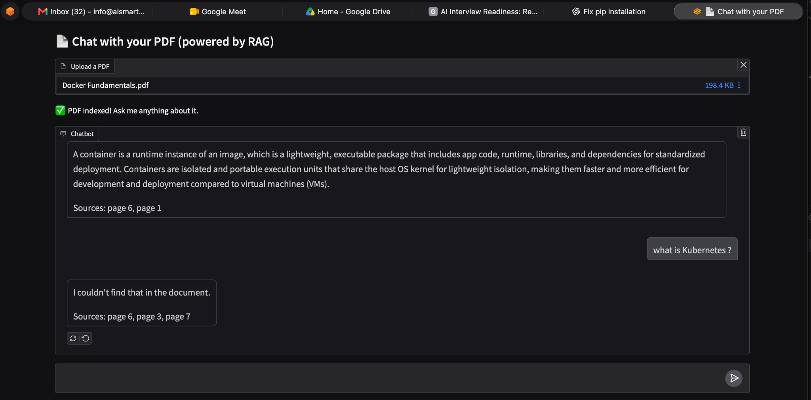

# 🚀 PDF Chat Assistant – Retrieval-Augmented Generation (RAG)

An end-to-end Generative AI application that allows users to upload PDF documents and ask questions through an AI-powered chatbot.

Built using Python, LangChain, OpenAI GPT-4o-mini, Hugging Face embeddings, ChromaDB and Gradio.

## 📌 Project Overview

This project demonstrates a complete Retrieval-Augmented Generation workflow.

Users can:
- Upload PDF documents.
- Extract text and page metadata.
- Split documents into smaller chunks.
- Generate vector embeddings.
- Store document vectors in ChromaDB.
- Retrieve relevant content using semantic search.
- Generate context-based answers using OpenAI.
- View answers with source page references.

## 🏗️ End-to-End RAG Architecture



### Document Ingestion and Indexing

1. User uploads a PDF.
2. PyPDFLoader extracts text and metadata.
3. RecursiveCharacterTextSplitter creates chunks.
4. Hugging Face generates embeddings.
5. ChromaDB stores chunks, vectors and metadata.

### Question Answering and Retrieval

1. User asks a question.
2. ChromaDB performs similarity search.
3. Up to four relevant chunks are retrieved.
4. Retrieved content and page references form the context.
5. GPT-4o-mini generates a context-based answer.
6. Gradio displays the response.

If the retrieved context does not contain the answer, the prompt instructs the model to say it could not find the information in the document.

## 🛠️ Technology Stack

| Technology | Purpose |
|---|---|
| Python 3.12 | Programming language |
| LangChain | RAG framework |
| OpenAI GPT-4o-mini | Answer generation |
| Hugging Face | Embeddings |
| all-MiniLM-L6-v2 | 384-dimensional embeddings |
| ChromaDB | Vector database |
| Gradio | Chat interface |
| PyPDF | PDF extraction |
| Sentence Transformers | Embeddings and reranking |

## 📂 Project Structure

```text
pdf-chat-rag-assistant/
├── embeddings.py
├── chunk.py
├── index.py
├── rag.py
├── rerank.py
├── pdf_chat.py
├── requirements.txt
├── .env.example
├── .gitignore
├── README.md
├── docs/
│   └── PROJECT_GUIDE.md
└── screenshots/
    ├── docker-fundamentals-chat-1.png
    ├── docker-fundamentals-chat-2.png
    └── rag-architecture-workflow.png
```

## ⚙️ Installation

### 1. Clone the repository

```bash
git clone https://github.com/Alamgir00/pdf-chat-rag-assistant.git
cd pdf-chat-rag-assistant
```

### 2. Create a virtual environment

```bash
python3 -m venv venv
source venv/bin/activate
```

### 3. Install dependencies

```bash
python -m pip install -r requirements.txt
```

### 4. Configure the API key

```bash
cp .env.example .env
```

Add your OpenAI API key to `.env`:

```text
OPENAI_API_KEY=your_openai_api_key_here
```

Never upload your actual `.env` file or API key.

## ▶️ Run the Application

```bash
python pdf_chat.py
```

Open the Gradio URL displayed in your terminal and upload a PDF.

For private local testing, use:

```python
demo.launch(share=False)
```

## 🖥️ Application Screenshots

### Screenshot 1 – PDF Upload and Chatbot Response



### Screenshot 2 – Document Question Answering



## 🧪 Application Testing

Test document: Docker Fundamentals.pdf

| Question | Observed result |
|---|---|
| What is Docker? | Document-based answer generated |
| What is a container? | Document-based answer generated |
| What is Kubernetes? | Application reported that it could not find the information in the document |

## 🧠 Core Concepts Implemented

### Embeddings
Converted text into 384-dimensional numerical vectors using all-MiniLM-L6-v2.

### Text Chunking
Used RecursiveCharacterTextSplitter.

PDF application configuration:
- Chunk size: 800 characters
- Chunk overlap: 100 characters

### Vector Database
Used ChromaDB to store document chunks and embeddings.

### Semantic Search
Retrieved relevant chunks based on similarity to the user's question.

### Retrieval-Augmented Generation
Passed retrieved document context to GPT-4o-mini to generate answers.

### Prompt Engineering
Instructed the model to answer using the supplied context.

### Reranking
Explored CrossEncoder-based relevance scoring in a separate demonstration.

## 📚 Python Source Files

| File | Description |
|---|---|
| embeddings.py | Generate embeddings and calculate similarity |
| chunk.py | Demonstrate text chunking |
| index.py | Build a ChromaDB index |
| rag.py | Demonstrate retrieval and generation |
| rerank.py | Demonstrate CrossEncoder reranking |
| pdf_chat.py | Complete PDF chatbot application |

## 🔮 Future Enhancements

- Multiple PDF support
- Persistent vector storage
- Integrated reranking
- Conversation history
- Retrieval evaluation
- Document management
- Authentication and authorization
- Secure cloud deployment

## 🔐 Security

- Store API keys in environment variables.
- Never commit `.env` or credentials.
- Exclude virtual environments and local databases.
- Do not upload confidential documents.
- Use authenticated deployment for sensitive information.

## 🎯 Learning Outcomes

- Generative AI fundamentals
- Retrieval-Augmented Generation
- Document ingestion and preprocessing
- Text embeddings
- Vector databases
- Semantic similarity search
- LangChain and prompt templates
- OpenAI API integration
- Gradio application development

## 👨‍💻 Author

**Sk Alamgir Ali**

Senior DevOps Engineer | Generative AI | RAG | Agentic AI | AWS | Azure | Kubernetes | Python | Automation

GitHub: https://github.com/Alamgir00

---

⭐ Thank you for exploring this project!
